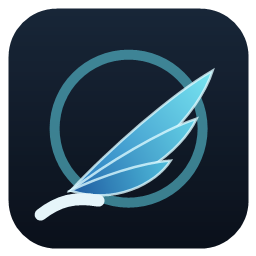

  

# Orta Recompiled - Android

An **experimental Android port** of [Orta Recompiled](https://github.com/almost-drowned-rat/Orta-Recompiled), the
static recompilation of *Panzer Dragoon Orta* (Xbox, Europe / PAL). One app: you pick your own disc image, the game
is translated and compiled **on your device** once, and then it plays - with touch controls or a gamepad.

> This project contains **no game data, no game code and no keys**. You need your own copy of the game (PAL disc
> image). The app never contains any of the game's code: it is built on your device from your own disc.

> **AI disclosure:**  AI assistance yes (Claude Code by Anthropic).

> **Just a small experiment.** This port was a small experiment to see how - and whether at all - the game would run
> on Android. It is not a finished release and it is not supported the way the PC version is.

> **I am sorry** for everyone whose device has no **Vulkan 1.3** and cannot use a **Turnip** driver either: the game
> needs one of the two, and on those devices it will not run. There is nothing I can do about that from the app's side.

---

## Status

**Source only for now.** A ready-to-install APK will follow here as a release once the matching toolkit sources are
published and the third-party licence texts are inside the app.

Tested on:

| Device | GPU | Driver | Result |
|---|---|---|---|
| Samsung Galaxy S23 | Adreno 740 | system (Vulkan 1.3) | runs, ~60 fps, picture + sound + touch |
| Samsung Galaxy Tab S8 | Adreno 730 | Turnip T30 (system driver: Vulkan 1.1 only) | runs, ~60 fps |
| AYN Odin 2 Portal | Adreno 740 | system | not tested yet |

## Requirements

- Android 10 or newer, **arm64** (64-bit ARM)
- **Vulkan 1.3**, or an Adreno GPU that can run a **Turnip** driver (Mesa, e.g.
  [purple-turnip](https://github.com/MrPurple666/purple-turnip/releases)). The app checks this at the first start and
  asks for a driver package (`.adpkg.zip`) when the system driver is too old. No driver is shipped with the app.
- Your own **Panzer Dragoon Orta (Europe)** disc image (`.iso`)
- Free storage: about **7 GB** during the first start (the image is copied in and extracted), about **3.5 GB** after it

## How it works

1. Install the app and start it.
2. On Adreno devices without Vulkan 1.3: choose a Turnip driver package when asked.
3. Choose your disc image in the system file picker. It is copied into the app and extracted (the copy is deleted
   afterwards; your own file stays where it is).
4. The game's code is translated and compiled on the device - **once**, about 8-10 minutes. Keep the screen on.
5. The game starts. Every later start goes straight into the game.

**Storage:** everything lives in the app's own storage. **Uninstalling the app deletes your saves** - keep that in mind.

## Controls

- **Touch:** a floating stick on the left, A B X Y, WHITE / BLACK, LT / RT and START. BACK, L3 / R3, the D-pad and
  a right stick exist too, hidden by default.
- **Gamepads** work out of the box. With the touch buttons on *Automatic* they hide while a gamepad is used. Every
  controller plays as player 1 (the game is single-player), so a handheld's own controls, a touch pad and an external
  pad all work at the same time.
- **BACK** opens a menu that slides in from the left: touch buttons on / off / automatic, move and resize them,
  button size, hide single buttons, opacity, stick sensitivity, the connected controllers and the graphics driver.
  The game keeps running behind it.

## Building

The APK is built on Linux with `tools/build_android.sh` (Android SDK 36, NDK r30, JDK 21, Gradle 9.9.1; the script
lists every path it reads as environment variables). It needs the toolkit,
[xboxrecomp-option-c](https://github.com/almost-drowned-rat/xboxrecomp-option-c), and its Android runtime SDK and
on-device compiler (made by the toolkit's `tools/android` scripts). The Android parts of the toolkit will be
published there.

## Licence

GPL-3.0-or-later (see `LICENSE`). Third-party parts the app uses: SDL3 (zlib), CPython (PSF), capstone (BSD-3),
libadrenotools (BSD-2), LLVM / clang / lld (Apache-2.0 with LLVM exception), the xboxrecomp toolkit (MIT, with
LGPL-2.1 parts from xemu); origins in `docs/sources.md`. A Turnip driver (Mesa, MIT) is never shipped - you choose it.

*Panzer Dragoon Orta* is a trademark of SEGA. This project is not affiliated with or endorsed by SEGA or Microsoft.
