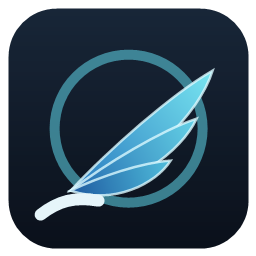

<p align="center">
  
</p>

# Orta Recompiled - Android

An **experimental Android port** of [Orta Recompiled](https://github.com/almost-drowned-rat/Orta-Recompiled), the
static recompilation of *Panzer Dragoon Orta* (Xbox, Europe / PAL). One app: you pick your own disc image, the game
is translated and compiled **on your device** once, and then it plays - with touch controls or a gamepad.

> This project contains **no game data, no game code and no keys**. You need your own copy of the game (PAL disc
> image). The app never contains any of the game's code: it is built on your device from your own disc.

> **AI disclosure:**  AI assistance yes (Claude Code by Anthropic).

> **Just a small experiment.** This port was a small experiment to see how - and whether at all - the game would run
> on Android. It is not a finished release and it is not supported the way the PC version is.

> **I am sorry** for everyone whose device has no **Vulkan 1.3** and cannot use a **Turnip** driver either: the game
> needs one of the two, and on those devices it will not run. There is nothing I can do about that from the app's side.

> **A Turnip driver is required.** Use the app with a **Turnip** driver (Mesa's open Vulkan driver for Adreno GPUs),
> not with the phone's own driver: the system drivers showed graphics glitches or were too old. Tested with
> **purple-turnip T30** - [`turnip_mrpurple_T30-toasted.adpkg.zip`](https://github.com/MrPurple666/purple-turnip/releases/tag/vturnip_mrpurple_T30-toasted.adpkg)
> (Mesa Turnip 26.3.0, Vulkan 1.4.359, by MrPurple666). Download that file to your device and choose it in the app
> (see *How it works*). The driver is not part of the app.

> **Only tested on Snapdragon.** I only have Android devices with a **Snapdragon 8 Gen 1** and a **Snapdragon 8 Gen 2**
> (Adreno 730 / 740), so I cannot test any other chip (Exynos, Tensor, MediaTek / Mali, older Snapdragons). And since
> this is just a small experiment, I will probably not put as much work into it as into the other ports.

---

## Status

**v1.3.0-scheduler.fix (experimental)** - the same version as the Windows / Linux port it is built from
([Orta-Recompiled v1.3.0](https://github.com/almost-drowned-rat/Orta-Recompiled/releases/tag/v1.3.0)), plus an
Android-only fix: the runtime's busy threads get a fast CPU core each, so the phone's power-saving scheduler no longer
makes the game miss frames (33 ms frames and a GAME SPEED of 92-98 % in v1.3.0). Download the APK from [Releases](https://github.com/almost-drowned-rat/Orta-Recompiled-Android/releases)
and install it (Android 10+, arm64). It is signed with the project's own key - every later update installs over it.

Tested on:

| Device | Chip / GPU | Driver | Result |
|---|---|---|---|
| AYN Odin 2 Portal | Snapdragon 8 Gen 2 / Adreno 740 | purple-turnip T30 | runs, borderless, built-in controls work (the system driver, Vulkan 1.3.128 on Android 13: graphics glitches) |
| Samsung Galaxy Tab S8 | Snapdragon 8 Gen 1 / Adreno 730 | purple-turnip T30 | v0.1.1: runs, 60 fps with MSAA 4x and bloom in the title's real-time demo (the system driver offers only Vulkan 1.1) |
| Samsung Galaxy S23 | Snapdragon 8 Gen 2 / Adreno 740 | purple-turnip T30 | v0.2.0: runs, touch aiming tested (Android 17; the system driver, Vulkan 1.3.128, runs too) |

## Features

- **The whole game, native on your device** - no emulator: the Xbox program is translated to C and compiled for
  arm64 on the device; the picture is drawn with **Vulkan**.
- **Built from your own disc** - the app carries no game code; the first start builds the game once (about 7-10
  minutes), then every start goes straight into the game.
- **One setup screen** (the standard of all my Android ports): your disc image and the graphics driver, a progress
  bar with the step and its time, **Quit** asks first and stops cleanly.
- **Graphics driver of your choice** - the system driver or a **Turnip** package (`.adpkg.zip`) from a file; up to 5
  packages are kept and can be switched in the BACK menu. No driver comes with the app.
- **Everything of the [PC port v1.3.0](https://github.com/almost-drowned-rat/Orta-Recompiled#readme)** - RECOMP
  OPTIONS in pages: POST PROCESSING (antialiasing, bloom, anisotropic filter, upscaling bilinear / FSR 1), DISPLAY
  (render resolution, aspect ratio 4:3 / 16:9 / 16:10 / 21:9, field of view; Android always runs full screen),
  PERFORMANCE (V-sync, FPS, frame time, game speed), RENDERING (shader compile mode, shader notice), BOOT ANIMATION.
- **Touch controls** with **touch aiming**, gamepads and a handheld's own controls.
- **BACK menu** - controls, saves export / import, log export, boot animation, graphics driver, licences.

## Requirements

- Android 10 or newer, **arm64** (64-bit ARM) - tested on Android 13 to 17
- An **Adreno GPU** and a **Turnip driver package** (`.adpkg.zip`) - **required**; tested with purple-turnip T30
  (link above). Without Turnip the game needs a system driver with **Vulkan 1.3**, and even then it may show
  graphics glitches. No driver is shipped with the app.
- Your own **Panzer Dragoon Orta (Europe)** disc image (`.iso`)
- Free storage: about **7 GB** during the first start (the image is copied in and extracted), about **3.5 GB** after it

## How it works

1. Install the app and start it. The setup screen opens.
2. **Browse...** your disc image.
3. **Graphics driver (change...)**: keep the *system driver*, or choose *Turnip driver from a file* and pick the
   Turnip package (`turnip_mrpurple_T30-toasted.adpkg.zip`, e.g. from your Download folder). You can change it any
   time later in **BACK > Settings > Graphics driver**. (On a device whose own driver is too old, the app asks for a
   Turnip package before the setup.)
4. **Install.** The image is copied into the app and extracted (the copy is deleted afterwards; your own file stays
   where it is), then the game's code is translated and compiled on the device - **once**, about 7-10 minutes (and
   once more after an app update, without asking for the disc again). Keep the app open; the screen stays on.
   **Quit** asks first, then stops cleanly.
5. **Play.** Every later start goes straight into the game.

**Frame rate at first:** while you play, the frame rate drops now and then at the beginning and gets better the longer
you play. That is the shader compilation: every new effect, scene or menu needs its shaders built once on the device,
and they are cached for the next time. After a while (and on every later start) it runs much smoother.

**Your files - saves and media:** they live in the app's folder in shared storage, reachable with adb or a file
manager (one that shows `Android/data`):

```
/storage/emulated/0/Android/data/io.github.almostdrownedrat.orta/files/
  saves/   your saves + settings.ini
  media/   boot.mpg (your own boot animation)
```

Back up your saves with `adb pull /sdcard/Android/data/io.github.almostdrownedrat.orta/files/saves`.
**Uninstalling the app deletes this folder too** - back up first. The game itself (translated and compiled from your
disc) stays in the app's internal storage.

**Boot animation (optional):** your own `boot.mpg` (MPEG-1 video + MP2 audio, like the PC port) plays before the
title. Either **BACK > Settings > Boot animation > Import file...**, or copy it with adb:
`adb push boot.mpg /sdcard/Android/data/io.github.almostdrownedrat.orta/files/media/`. Turn it on / off in the game:
OPTIONS > RECOMP OPTIONS > BOOT ANIMATION. **BACK > Settings > Boot animation > None** removes it again.

## Controls

- **Touch:** a floating stick on the left, A B X Y, WHITE / BLACK, LT / RT and START. BACK, L3 / R3, the D-pad and
  a right stick exist too, hidden by default.
- **Touch aiming** (BACK > Controls > Touch layout: *Touch aiming*): in flight your finger is the reticle - touch to
  aim (A held), drag over enemies to lock on, lift to fire. The view turns only with LT / RT; swipes up / down / left
  / right move through the menus. The aiming layout shows only X (boost), B (brake), Y (form), LT / RT, WHITE
  (berserk) and START; outside flight the normal layout comes back.
- **Gamepads** work out of the box. With the touch buttons on *Automatic* they hide while a gamepad is used. Every
  controller plays as player 1 (the game is single-player), so a handheld's own controls, a touch pad and an external
  pad all work at the same time.
- **BACK** opens a menu that slides in from the left (the game keeps running behind it), in the same order as in all
  my Android ports:
  - **Back to the game**
  - **Controls** - touch buttons on / off / automatic, touch layout (stick / touch aiming), the connected
    controllers, move and resize the touch buttons, button size, hide single buttons, opacity, stick sensitivity,
    reset the layout
  - **Settings**
    - **Saves** - export your saves as one zip, or import such a zip (your current saves are kept as a backup)
    - **Export log** - the log of one of the last 5 starts, or of all of them, to a file you choose - please attach
      it to a bug report
    - **Boot animation** - none, or import your boot.mpg
    - **Graphics driver** - the driver in use, up to 5 kept Turnip packages (add / remove), the system driver
    - **About and licences**

## Troubleshooting

| What you see | Why | What to do |
|---|---|---|
| "App not installed" when installing | Android older than 10, or a 32-bit / x86 device | the app needs Android 10+ on arm64 - it cannot run on this device |
| "Graphics driver needed" at the first start | an Adreno GPU whose own driver offers less than Vulkan 1.3 | choose a Turnip package (link above) |
| A message on the setup screen, then the app closes | a step of the build failed | **BACK > Settings > Export log** after the next start, or `adb logcat`; please open an issue |
| "I am sorry - ... offers only Vulkan ..." at the first start | no Adreno GPU (Mali, Xclipse, PowerVR, ...) and less than Vulkan 1.3 | Turnip exists only for Adreno - the game cannot run on this device |
| "Turnip drivers work only on Adreno GPUs" | a Turnip package chosen on a device without an Adreno GPU | keep the system driver |
| "Not enough storage" after choosing the image | the first start needs about twice the image's size free | free some storage and choose the image again |
| The progress bar runs for minutes | the game is translated and compiled on the device (first start, after an update) | wait - about 7-10 minutes |
| Black screen, then the app closes | not known yet | **BACK > Settings > Export log**, choose the run before "this run", and attach the file to an issue together with your device |
| Graphics glitches | the phone's own driver | use Turnip T30 (BACK > Settings > Graphics driver) |

## Building

The APK is built on Linux with `tools/build_android.sh` (Android SDK 36, NDK r30, JDK 21, Gradle 9.9.1; the script
lists every path it reads as environment variables). It needs the toolkit,
[xboxrecomp-option-c **v1.3.0**](https://github.com/almost-drowned-rat/xboxrecomp-option-c/releases/tag/v1.3.0) with
the Android change `xboxrecomp-option-c-v1.3.0-scheduler-fix.patch` from the
[v1.3.0-scheduler.fix release](https://github.com/almost-drowned-rat/Orta-Recompiled-Android/releases/tag/v1.3.0-scheduler.fix)
(the exact toolkit source is inside the app), and its Android runtime SDK and on-device compiler, made by the toolkit's
`tools/android` scripts (Linux and Android changes: its `docs/option_c.md`, section 7). The release APK is signed with
the project's own release key; `tools/build_android.sh --release` expects it outside the repository.

## Licence

GPL-3.0-or-later (see `LICENSE`). Third-party parts the app uses: SDL3 (zlib), CPython (PSF), capstone (BSD-3),
libadrenotools (BSD-2), LLVM / clang / lld (Apache-2.0 with LLVM exception), the xboxrecomp toolkit (MIT, with
LGPL-2.1 parts from xemu - the sound core is its own library in the app, `libxbox_apu.so`; its source is the LGPL
source zip attached to each release); origins in `docs/sources.md`. A Turnip driver (Mesa, MIT) is never shipped - you choose it.

*Panzer Dragoon Orta* is a trademark of SEGA. This project is not affiliated with or endorsed by SEGA or Microsoft.
